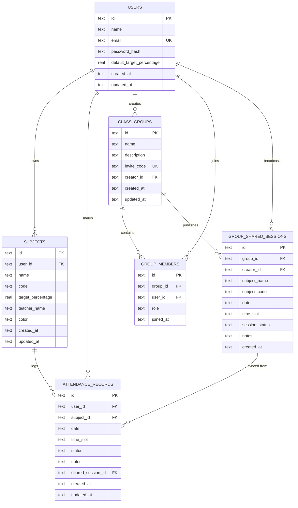

# Technical Architecture Documentation: Shared Self-Attendance Tracker

## 1. System Overview

**Shared Self-Attendance Tracker** is a secure, full-stack web application designed for students to independently monitor course attendance, detect attendance shortages in advance, simulate future attendance trajectories, and optionally collaborate with classmates by exchanging timetable events and cancellation alerts.

The system is designed with a strict principle of **student tenant privacy**: while peer collaboration allows broadcasting class sessions, personal attendance records remain completely isolated and tamper-proof.

---

## 2. System Architecture Diagram

```mermaid
graph TD
    subgraph ClientLayer ["Client Layer (React 18 + Vite + Tailwind CSS)"]
        UI_Nav[Navigation & Theme Context]
        UI_Dash[Dashboard & Recharts Visualizations]
        UI_Subj[Subject Management UI]
        UI_Mark[Mark Attendance & Rapid Entry]
        UI_Hist[Attendance History & CSV Exporter]
        UI_Calc[Projection & Shortage Calculator]
        UI_Group[Shared Class Groups & 1-Click Sync]
        UI_Auth[Auth Provider & JWT Interceptor]
    end

    subgraph APILayer ["Backend API Layer (Node.js 24 + Express + TypeScript)"]
        MW_Auth[JWT Authentication & Tenant Isolation Middleware]
        RT_Auth[/api/auth - Login / Register / Profile]
        RT_Subj[/api/subjects - Course Management]
        RT_Att[/api/attendance - Records & Duplicate Guard]
        RT_Group[/api/groups - Collaboration & 1-Click Sync]
        RT_Stats[/api/stats - Analytics & Projections]
        CalcEngine[Mathematical Calculation Engine]
    end

    subgraph DataLayer ["Data & Storage Layer"]
        SQLite[(node:sqlite Native Engine - WAL Mode)]
        Postgres[(PostgreSQL / Supabase + RLS Optional)]
    end

    UI_Auth -->|Bearer JWT| MW_Auth
    UI_Dash -->|REST Requests| RT_Stats
    UI_Subj -->|REST Requests| RT_Subj
    UI_Mark -->|REST Requests| RT_Att
    UI_Hist -->|REST Requests| RT_Att
    UI_Calc -->|REST Requests| RT_Stats
    UI_Group -->|REST Requests| RT_Group

    RT_Stats --> CalcEngine
    RT_Subj --> CalcEngine
    RT_Att --> CalcEngine

    RT_Auth --> SQLite
    RT_Subj --> SQLite
    RT_Att --> SQLite
    RT_Group --> SQLite
    RT_Stats --> SQLite
```

---

## 3. Database Schema & Entity Relationships



---

## 4. Mathematical Engine Specifications

### 4.1 Conducted Classes Definition
Cancelled sessions are strictly excluded from the total conducted count:
$$\text{Conducted} = \text{Attended} + \text{Absent}$$

### 4.2 Attendance Percentage
$$\text{Attendance \%} = \begin{cases} 0.0\% & \text{if Conducted} = 0 \\ \frac{\text{Attended}}{\text{Conducted}} \times 100 & \text{if Conducted} > 0 \end{cases}$$

### 4.3 Shortage Solver (Consecutive Classes Required)
Given a target threshold fraction $T = \frac{\text{targetPercentage}}{100}$ (where current percentage $< T$):
$$\frac{A + x}{C + x} \ge T \implies x(1 - T) \ge T \cdot C - A \implies x = \left\lceil \frac{T \cdot C - A}{1 - T} \right\rceil$$

**Edge Case (Target = 100%)**:
If $T = 1.0$ and $A < C$ (student has missed at least 1 class), $100\%$ attendance cannot ever be achieved mathematically. The engine returns `isTargetAchievable: false` and sets `classesNeeded: Infinity`.

### 4.4 Safe Margin Solver (Classes Allowed to Miss)
When current attendance meets or exceeds target ($P \ge T$):
$$\frac{A}{C + y} \ge T \implies A \ge T(C + y) \implies y \le \frac{A - T \cdot C}{T} \implies y = \left\lfloor \frac{A - T \cdot C}{T} \right\rfloor$$

---

## 5. REST API Catalog

| Method | Endpoint | Description | Auth Required |
|---|---|---|---|
| `POST` | `/api/auth/register` | Register new student account | No |
| `POST` | `/api/auth/login` | Authenticate and obtain JWT | No |
| `GET` | `/api/auth/me` | Fetch authenticated profile | Yes |
| `PUT` | `/api/auth/profile` | Update student name & default target % | Yes |
| `PUT` | `/api/auth/change-password` | Update account password | Yes |
| `GET` | `/api/subjects` | List student subjects with live stats | Yes |
| `POST` | `/api/subjects` | Create subject with code & custom target | Yes |
| `PUT` | `/api/subjects/:id` | Modify subject details | Yes |
| `DELETE` | `/api/subjects/:id` | Delete subject and cascade records | Yes |
| `GET` | `/api/attendance` | Retrieve records with multi-filters | Yes |
| `POST` | `/api/attendance` | Mark class (with collision guard) | Yes |
| `PUT` | `/api/attendance/:id` | Edit attendance status or notes | Yes |
| `DELETE` | `/api/attendance/:id` | Remove attendance entry | Yes |
| `GET` | `/api/attendance/export/csv` | Download RFC-4180 CSV file | Yes |
| `GET` | `/api/groups` | List enrolled class groups | Yes |
| `POST` | `/api/groups` | Create group with 6-char invite code | Yes |
| `POST` | `/api/groups/join` | Join group via invite code | Yes |
| `GET` | `/api/groups/:id` | Get group roster and session bulletin | Yes |
| `POST` | `/api/groups/:id/sessions` | Broadcast lecture or cancellation | Yes |
| `POST` | `/api/groups/sessions/:id/sync` | 1-Click Sync shared session to user records | Yes |
| `DELETE` | `/api/groups/:id` | Delete group (creator only) | Yes |
| `DELETE` | `/api/groups/sessions/:id` | Delete broadcast (poster/admin only) | Yes |
| `GET` | `/api/stats/dashboard` | Dashboard metrics and Recharts datasets | Yes |
| `POST` | `/api/stats/project` | What-if future projection simulator | Yes |
| `GET` | `/api/health` | Service uptime and health status | No |

---

## 6. Security & Tenant Privacy Model

1. **Authentication**: Stateless HMAC-SHA256 JSON Web Tokens (JWT) issued on login/signup, valid for 30 days.
2. **Password Security**: Salted hashes generated using `bcryptjs` (work factor 10).
3. **Tenant Isolation**: Every database query on `subjects` and `attendance_records` is bounded by `WHERE user_id = ?`.
4. **Collision Prevention**: Unique constraint `(user_id, subject_id, date, time_slot)` prevents duplicate entries for the same class session.
5. **Role-Based Access Control (RBAC)**:
   - In shared class groups, users are either `admin` (group creator) or `member`.
   - Any member can broadcast a timetable update.
   - Syncing a broadcast session creates a record owned exclusively by that student.
   - No classmate can ever alter or view another student's private percentage.
